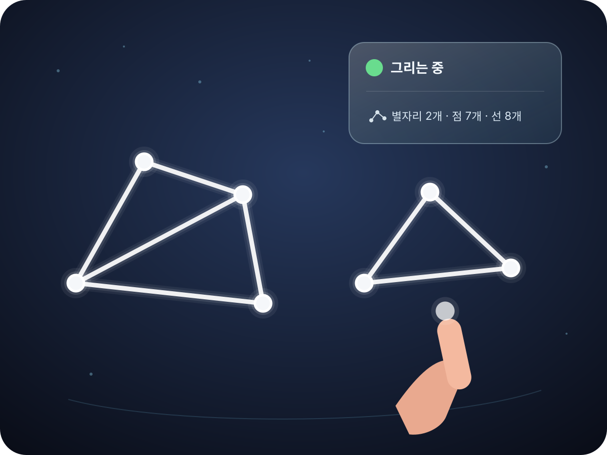

# Hand Constellation

ARKit의 visionOS Hand Tracking으로 오른손 검지 끝을 인식하고, 공중에 점과 선을 그리는 SwiftUI 튜토리얼 프로젝트입니다. 새 위치에서는 점을 만들고 기존 점에서는 중복 점 없이 선만 다시 연결하므로, 어느 점에서든 가지를 이어 복합적인 별자리를 만들 수 있습니다.



## 완성 동작

1. **별자리 그리기 시작**을 바라보고 엄지와 검지를 맞대어 몰입형 공간을 엽니다.
2. 공간은 **멈춤** 상태로 열립니다. 제어창의 **그리기 시작** 버튼을 눌러야 입력을 받습니다.
3. 오른손 검지 끝의 흰색 커서를 원하는 위치에 둡니다.
4. 작은 범위 안에서 약 0.8초 동안 머물면 흰색 점이 생깁니다.
5. 손가락을 3cm 이상 옮긴 다음 다시 머물면 새 점이 생기고 앞 점과 흰색 선으로 이어집니다.
6. 원하는 기존 점의 3cm 안에서 머물면 새 점 없이 기존 점까지 선만 연결됩니다.
7. 연결한 기존 점이 다음 선의 시작점이 되므로 그 점에서 계속 가지를 그릴 수 있습니다.
8. 이미 선으로 이어진 점에는 선을 다시 만들지 않고 이유를 안내합니다.
9. 제어창의 **그리기 멈춤** 버튼으로 입력을 멈춥니다. 그린 점과 선은 남습니다.
10. 그리기를 다시 켠 뒤 만드는 첫 점은 이전 별자리와 연결되지 않고 새 별자리를 시작합니다.
11. **초기화**로 모든 별자리의 점과 선을 지울 수 있습니다.

Simulator에는 손 추적이 없습니다. 대신 Simulator에서 몰입형 공간을 열면 제어창 오른쪽에 입력 패드가 나타나고, 패드를 누른 채 멈추면 검지를 멈춘 것처럼 동작합니다. 그래서 기기 없이도 같은 순서로 점과 선을 그려 볼 수 있습니다. 이 입력은 `#if targetEnvironment(simulator)` 안에만 있어 기기용 빌드에는 들어가지 않습니다.

## 개발 환경

- Xcode 16 이상과 visionOS SDK
- SwiftUI, ARKit, RealityKit
- 실제 손으로 그리고 권한 창을 확인하려면 visionOS 2.0 이상을 실행하는 Apple Vision Pro

기기가 없어도 visionOS Simulator와 입력 패드로 튜토리얼의 그리기 실습까지 따라 할 수 있습니다.

Xcode Settings > Components에서 visionOS 플랫폼과 필요한 Simulator runtime을 먼저 설치하세요.

## 스타터 프로젝트

튜토리얼은 공간 컴퓨팅에 필요한 코드만 직접 작성합니다. 앱 상태, 제어창 화면, 설정값, 별자리 모델, 기존 점 연결 감지기, Simulator 전용 입력 패드는 [`StarterProject/HandConstellation`](StarterProject/HandConstellation)에 완성본으로 들어 있습니다. 렌더러의 기존 점 연결 안내, 코디네이터의 속성·`init`·보조 메서드, 머무르기 테스트 6개(`HandConstellationTests/DwellDetectorTests.swift`)도 스타터가 제공합니다. 비어 있는 곳에는 `// Chapter 3에서 작성합니다.`처럼 작성할 Chapter가 적혀 있습니다.

튜토리얼에서 직접 작성하는 코드는 다음과 같습니다.

- Chapter 1: Info 탭에 손 추적 사용 목적(`NSHandsTrackingUsageDescription`) 추가
- Chapter 2: `HandTrackingService` 전체(지원·권한 확인, `ARKitSession` 실행, 검지 끝의 월드 좌표)
- Chapter 3: `DwellDetector.update(position:at:)`, `ConstellationRenderer`의 점·선·커서와 `#Preview`
- Chapter 4: `ImmersiveCoordinator`의 `run`·`reset`·`stop`과 한 프레임 처리 순서, `ImmersiveView` 전체, `ImmersiveSpace` 등록, `ControlView`의 `toggleImmersiveSpace()`

Chapter 1의 「스타터 프로젝트 살펴보고 실행하기」 페이지에 있는 **Project files** 버튼은 같은 내용을 담은 `HandConstellation-Starter.zip`을 내려받습니다.

스타터의 Swift 파일과 zip은 `Scripts/build_starter_project.py`가 앱 소스에서 만듭니다. 어느 줄을 어느 Step에서 작성하는지는 `Scripts/generate_snapshots.py`에 적혀 있고, 스타터는 그 0번째 상태입니다. 앱 소스를 고친 뒤에는 `./Scripts/verify-snapshots.sh --generate`로 함께 갱신하세요.

## 실행하기

완성 앱을 실행하는 방법입니다. 튜토리얼을 따라 하려면 위의 스타터 프로젝트로 시작하세요.

1. `HandConstellation.xcodeproj`를 Xcode에서 엽니다.
2. HandConstellation 타깃의 Signing & Capabilities에서 Team을 선택합니다.
3. `com.example.HandConstellation`을 본인의 고유한 Bundle Identifier로 바꿉니다.
4. Apple Vision Pro를 실행 대상으로 선택하고 앱을 Run합니다.
5. **별자리 그리기 시작**으로 몰입형 공간을 열고, 손 추적 권한 창이 뜨면 허용합니다.
6. **그리기 시작**을 누르고 오른손 검지를 한곳에 0.8초 머무릅니다.

손 추적 사용 설명은 `HandConstellation/Info.plist`에 포함되어 있습니다.

Simulator에서는 서명 없이 실행 대상을 Apple Vision Pro Simulator로 두고 Run합니다. 공간을 열면 상태가 **Simulator 입력**으로 바뀌고, **그리기 시작**을 누른 뒤 제어창 오른쪽의 입력 패드를 누른 채 0.8초 멈추면 점이 찍힙니다.

## 프로젝트 구조

```text
HandConstellation/
├── HandConstellationApp.swift        제어창과 몰입형 공간 장면을 선언하는 진입점
├── AppModel.swift                    제어창과 몰입형 공간이 함께 보는 상태
├── ControlView.swift                 시작·종료·그리기 전환·초기화 창
├── SimulatorInputPad.swift           Simulator에서 검지를 대신하는 입력 패드
├── ImmersiveView.swift               RealityView와 추적 작업
├── HandTrackingService.swift         권한·ARKitSession·검지 좌표
├── ConstellationConfiguration.swift  머무르기·거리·크기 설정값
├── DwellDetector.swift               머무르기 상태 머신
├── ExistingPointConnectionDetector.swift  기존 점 목표 고르기와 연결 판정
├── ConstellationModel.swift          별자리별 점과 선, 연결 규칙
├── ConstellationRenderer.swift       흰색 점·선·커서·연결 안내
├── ImmersiveCoordinator.swift        손 추적·판정·모델·렌더러를 한 프레임 순서로 연결
└── HandConstellation.docc/           DocC 튜토리얼
HandConstellationTests/               머무르기·기존 점 연결·모델 테스트와 코디네이터 통합 테스트
StarterProject/HandConstellation/     튜토리얼을 시작하는 스타터 Xcode 프로젝트(머무르기 테스트 포함)
DocumentationTheme/                   확대된 단계·코드 패널용 DocC 렌더 테마
Scripts/                              코드 스냅샷·스타터·튜토리얼 이미지 생성과 검증
```

설계 근거와 조사 결과는 [PROJECT_REQUIREMENTS.md](PROJECT_REQUIREMENTS.md), 완성 튜토리얼은 [배포된 사이트](https://82twj.github.io/visionOS_tutorial/tutorials/handconstellationtutorials/)에서, 원본은 [DocC 카탈로그](HandConstellation/HandConstellation.docc)에서 확인할 수 있습니다.

## 검증하기

호스트 macOS에서 ARKit과 무관한 머무르기·기존 점 연결·그래프 모델 테스트 23개를 실행합니다.

```shell
swift test
```

visionOS 앱 타깃을 코드 서명 없이 빌드합니다.

```shell
xcodebuild \
  -project HandConstellation.xcodeproj \
  -scheme HandConstellation \
  -destination 'generic/platform=visionOS' \
  CODE_SIGNING_ALLOWED=NO \
  build
```

visionOS Simulator에서는 위 테스트에 더해 코디네이터 통합 테스트를 실행합니다. 가짜 검지 위치를 `process(position:at:appModel:)`에 넣어 Chapter 5의 순서(점 4개와 선 5개, 이미 이어진 점 거절, 두 번째 별자리, 초기화)를 재현하고 제어창의 개수와 렌더러의 엔티티 수를 검사합니다. `--starter`를 붙이면 스타터 프로젝트의 Chapter 3 끝 상태에서 머무르기 테스트를 실행합니다.

```shell
./Scripts/run-simulator-tests.sh
./Scripts/run-simulator-tests.sh --starter
```

튜토리얼의 코드 Step마다 앱이 경고 없이 빌드되는지는 다음 명령으로 확인합니다. 스타터 상태와 Step을 하나씩 적용한 상태를 기기용·Simulator용으로 타입 검사합니다.

```shell
./Scripts/verify-snapshots.sh --builds
```

로컬 Xcode에 visionOS platform component가 없고 SDK만 있다면 다음처럼 SDK를 직접 지정해 컴파일할 수 있습니다.

```shell
xcodebuild \
  -project HandConstellation.xcodeproj \
  -target HandConstellation \
  -configuration Debug \
  -sdk xros \
  -arch arm64 \
  CODE_SIGNING_ALLOWED=NO \
  build
```

## DocC 문서 빌드

Xcode의 Product > Build Documentation을 사용하거나 명령줄에서 실행합니다.

```shell
xcodebuild \
  -project HandConstellation.xcodeproj \
  -target HandConstellation \
  -configuration Debug \
  -sdk xros \
  -arch arm64 \
  CODE_SIGNING_ALLOWED=NO \
  docbuild
```

튜토리얼은 5개 Chapter에 튜토리얼 11개와 글 5개(시작 글, Chapter 2–5의 마무리 글)가 있습니다. Chapter 1은 스타터 프로젝트를 Simulator에서 실행해 읽고 손 추적 권한 설명을 추가합니다. Chapter 2는 손 추적 서비스를 작성하고, Chapter 3은 머무르기 판정과 RealityKit 렌더러를 작성해 테스트와 `#Preview`로 확인합니다. Chapter 4는 코디네이터와 몰입형 공간을 연결해 Simulator 입력 패드로 점과 선을 그려 봅니다. Chapter 5는 Apple Vision Pro에서 권한을 허용한 뒤 기존 점 연결, 그리기 전환과 두 번째 별자리, 초기화를 확인하며, 그리기 실습은 Simulator 입력 패드로도 따라 할 수 있습니다. 코드를 쓰는 단계는 이전 코드와 달라진 줄을, 코드를 읽는 단계는 설명하는 줄을 강조합니다. 문제 해결 안내는 결과를 확인하는 단계의 캡션에 있습니다.

빌드한 아카이브에는 아래 후처리를 실행해야 합니다. GitHub Actions는 이 절차를 자동 실행합니다.

- 한국어 Chapter 이름의 DocC 경로 충돌로 생기는 다음 링크와 소속 Chapter 오류를 목차 기준으로 바로잡습니다.
- 각 튜토리얼의 섹션 주소를 `section-1`, `section-2`처럼 영문으로 바꿉니다. DocC는 한글 섹션 주소를 페이지에는 한글로, 섹션 메뉴의 링크에는 퍼센트 인코딩으로 써서 메뉴에서 골라도 이동하지 않기 때문입니다.
- 삭제되거나 합쳐진 페이지 13개의 이전 주소를 새 페이지로 연결합니다.
- 튜토리얼만 배포합니다. 앱 타깃을 docbuild하면 앱의 타입 목록을 담은 모듈 문서(`documentation/handconstellation`)가 함께 생기는데, 이 데이터를 지우고 그 주소와 사이트 첫 주소를 튜토리얼 개요로 연결합니다.

```shell
python3 Scripts/normalize_docc_navigation.py /path/to/HandConstellation.doccarchive
python3 Scripts/verify_tutorial.py --archive /path/to/HandConstellation.doccarchive
```

프로젝트의 `DOCC_TEMPLATE_PATH`가 `DocumentationTheme`을 가리키므로 Xcode와 명령줄 빌드 모두 확대된 단계 카드, 파란 현재 단계 표시, 큰 코드 패널 스타일을 동일하게 적용합니다. 테마의 `js/handconstellation-step-sync.js`는 현재 단계가 바뀔 때 오른쪽 코드 패널만 스크롤해 강조된 줄이 보이도록 맞춥니다. 페이지 자체의 스크롤 위치는 건드리지 않고, 좁은 화면에서는 동작하지 않습니다.

## GitHub Pages 배포

`.github/workflows/documentation.yml`이 `main` 브랜치의 DocC를 정적 사이트로 배포합니다.

1. GitHub 저장소 Settings > Pages에서 Source를 **GitHub Actions**로 선택합니다.
2. 프로젝트를 `main` 브랜치에 push합니다.
3. Actions 탭에서 **Deploy DocC to GitHub Pages**가 완료될 때까지 기다립니다.
4. [배포된 Hand Constellation 튜토리얼](https://82twj.github.io/visionOS_tutorial/tutorials/handconstellationtutorials/)을 엽니다.

workflow는 저장소 이름을 `DOCC_HOSTING_BASE_PATH`로 자동 설정합니다. 사용자/조직 Pages처럼 도메인 루트에 배포할 때는 이 값을 빈 문자열로 바꾸세요.

workflow는 본문·스냅샷·스타터 검사(`verify-snapshots.sh`), 스타터 빌드, 경고를 오류로 처리하는 `docbuild`, 위의 후처리와 아카이브 검사를 거친 뒤 배포합니다. 같은 브랜치에서 배포가 겹치면 앞의 실행을 취소합니다. Simulator 테스트와 Step별 타입 검사(`--builds`)는 실행하지 않으므로 로컬에서 실행하세요.

배포가 실패하면 다음을 확인합니다.

- visionOS destination 오류: runner의 Xcode 버전과 설치된 플랫폼
- 스타터 검사 실패: 앱 소스를 바꾼 뒤 `./Scripts/verify-snapshots.sh --generate`를 실행했는지
- "unreferenced catalog assets" 또는 "missing catalog resource": 본문에서 쓰지 않는 파일이 카탈로그에 남았거나, 본문이 참조하는 파일이 없음
- 배포 후 스타일이 깨짐: `DOCC_HOSTING_BASE_PATH`가 저장소 이름과 같은지
- 404 오류: Pages Source가 GitHub Actions인지, deploy job이 성공했는지

## 튜토리얼 자료 다시 만들기

튜토리얼의 코드 스냅샷과 개념 그림은 스크립트로 생성합니다. `capture-*` 파일은 실제 Xcode·Simulator 화면 캡처이며 그림 생성기가 덮어쓰지 않습니다. Xcode 캡처는 `Scripts/process_capture.swift`로 창 모서리 밖을 투명하게 하고 설명하는 영역만 밝게 남깁니다. Simulator 캡처는 `xcrun simctl io booted screenshot`으로 장면만 찍습니다. 앱 소스를 고친 뒤에는 다음을 실행해 스냅샷을 다시 만들고 참조를 검사하세요.

```shell
./Scripts/verify-snapshots.sh --generate
```

`./Scripts/verify-snapshots.sh`를 옵션 없이 실행하면 파일을 수정하지 않고 검사만 합니다. `--builds`를 붙이면 스타터 상태와 코드 Step 하나하나를 적용한 상태를 기기용·Simulator용으로 타입 검사해, 어느 Step에서 멈춰도 경고 없이 빌드되는지 확인합니다.

특정 Chapter를 마친 상태의 프로젝트가 필요하면 다음처럼 내보냅니다. `--chapter`에는 0–4를 쓸 수 있고, 0은 스타터 그대로입니다.

```shell
python3 Scripts/build_starter_project.py --export ../HandConstellation-Chapter3 --chapter 3
```

튜토리얼에서 작성하는 파일의 마지막 스냅샷은 실제 앱 소스와 바이트 단위로 같아야 하고, 스타터 프로젝트의 파일과 zip은 앱 소스·첫 스냅샷과 일치해야 합니다. 스크립트가 둘 다 검사합니다. 코드를 읽는 단계의 강조 기준 파일(`HL-*.swift`)도 같은 스크립트가 만들고, DocC가 실제로 강조할 줄을 Swift 표준 라이브러리의 diff로 확인합니다. 그림을 다시 만들려면 다음을 실행합니다. `--only`로 고친 그림만 다시 쓸 수 있습니다.

```shell
python3 Scripts/generate_images.py --only interaction-dwell,fingertip-world-example
```

## 현재 검증 범위

- visionOS SDK 대상 앱, 스타터 프로젝트, 스타터에 코드 Step을 하나씩 적용한 29개 상태가 기기용·Simulator용으로 경고 없이 타입 검사 통과
- `swift test`: 판정·모델 테스트 23개 통과
- visionOS Simulator: 완성 앱 테스트 30개(코디네이터 통합 테스트 7개 포함), 스타터의 머무르기 테스트 6개 통과
- DocC 아카이브가 경고 없이 빌드됨(경고를 오류로 처리)
- 화면에 나오는 모든 코드 스냅샷이 Swift 문법 검사를 통과하고, 작성 파일의 마지막 스냅샷이 실제 앱 소스와 일치
- 스타터 프로젝트 파일과 zip이 앱 소스·첫 스냅샷과 일치하고, Xcode 27.1에서 경고 없이 열림
- 생성된 16개 페이지(튜토리얼 11개, 글 5개)의 본문·자료 참조·다음 링크·5개 Chapter·퀴즈 구조, 섹션 메뉴 링크와 섹션 주소의 일치, 이전 주소 13개를 검사
- Simulator에서 입력 패드로 점과 선을 그리는 것, Xcode 캔버스의 `#Preview`를 직접 확인
- 캡처는 모두 스타터 프로젝트와 완성 앱으로 Xcode 27.1, visionOS 27.0 Simulator에서 새로 찍음
- Chapter 5의 화면은 Simulator 입력 패드로 그린 Simulator 캡처이며, 실제 기기의 손 추적 동작과 권한 창은 Apple Vision Pro에서 최종 확인 필요

2026-11-24 재점검과 수정은 [점검 결과와 수정 계획](TUTORIAL_20261124_AUDIT_AND_PLAN.md), [코드 Step 지도](TUTORIAL_20261124_STEP_MAP.md), [검증 기록](TUTORIAL_20261124_VERIFICATION.md)을 참고하세요. 2026-11-14 피드백 대응은 [피드백 매칭 기록](20261114_FeedBack/FEEDBACK_MATCHING.md), [수정 계획](TUTORIAL_20261114_REVISION_PLAN.md), [검증 기록](20261114_FeedBack/verification/VERIFICATION.md)에 있습니다.
